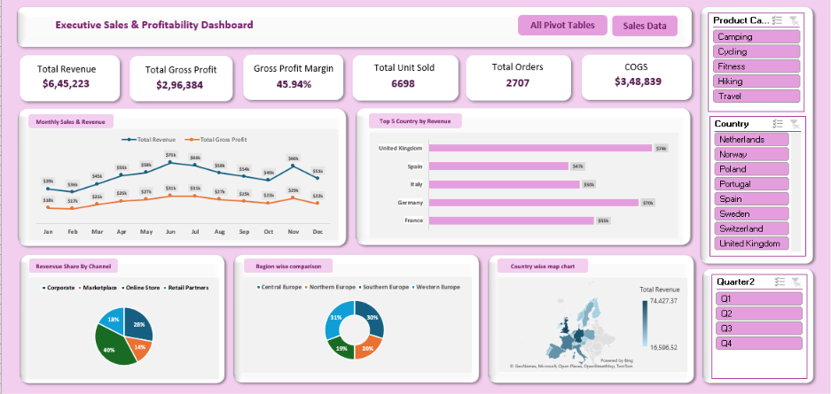

# 📊 Executive Sales & Profitability Dashboard

## 📌 Project Overview

The **Executive Sales & Profitability Dashboard** is an interactive Microsoft Excel project developed to analyze sales performance, revenue, gross profit, and regional trends. It brings key performance indicators (KPIs) and visualizations together in a single dashboard to support data-driven decision-making.

## 🎯 Project Objectives

- Analyze overall sales and profitability performance.
- Track key business performance indicators.
- Compare monthly revenue and gross profit trends.
- Identify top-performing countries by revenue.
- Analyze revenue contribution across sales channels.
- Compare revenue performance across regions.
- Explore data interactively using slicers.

## 🛠️ Tools & Technologies

- Microsoft Excel
- Excel Tables and formulas
- PivotTables
- PivotCharts
- Interactive slicers
- Data visualization

## 📈 Key Performance Indicators (KPIs)

The dashboard includes:

- **Total Revenue** — measures overall sales value.
- **Total Gross Profit** — shows profit generated before operating expenses.
- **Gross Profit Margin (%)** — measures gross profit as a percentage of revenue.
- **Total Units Sold** — summarizes sales volume.
- **Total Orders** — indicates transaction activity.
- **Cost of Goods Sold (COGS)** — represents the cost associated with the goods sold.

## 📊 Dashboard Features

### 1. Monthly Revenue & Profit
Visualizes monthly revenue and gross profit to help review trends over time.

### 2. Top 5 Countries by Revenue
Compares the five countries with the highest revenue.

### 3. Revenue Share by Channel
Shows how different sales channels contribute to total revenue.

### 4. Region-wise Comparison
Compares revenue performance across regions.

### 5. Country-wise Map Chart
Displays geographic revenue distribution across countries.

### 6. Interactive Filters
Allows users to explore the dashboard using slicers for:
- Product Category
- Country
- Quarter

## 🖼️ Dashboard Preview

## 🔍 Analysis Workflow

1. Reviewed and organized the sales data.
2. Prepared the data for analysis.
3. Used Excel formulas and PivotTables to summarize metrics.
4. Created PivotCharts to visualize sales and profitability.
5. Added KPI cards and interactive slicers.
6. Organized the visualizations into an executive dashboard.

*Keep these steps only if they accurately describe the work you completed.*

## 💡 Business Value

This dashboard helps users monitor key performance indicators, compare sales across countries and regions, understand channel contribution, and explore revenue and profitability trends in one place.

## 📂 Project Files

- `Sales_Profitability_Dashboard.xlsx` — Excel workbook containing the dashboard.
- `dashboard-preview.png` — Screenshot of the dashboard.

## 🚀 Skills Demonstrated

- Microsoft Excel
- Data analysis and summarization
- KPI reporting
- PivotTables and PivotCharts
- Interactive dashboard development
- Business data visualization

## 📌 Future Improvements

- Add verified business insights and recommendations.
- Improve automated data refresh and reporting.
- Expand the analysis to include product and customer performance.

---

**Project Category:** Data Analytics  
**Tool:** Microsoft Excel
